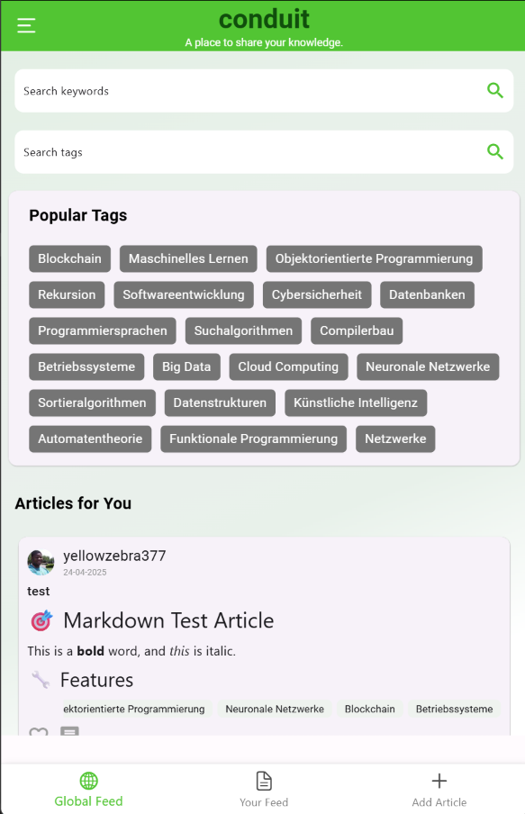
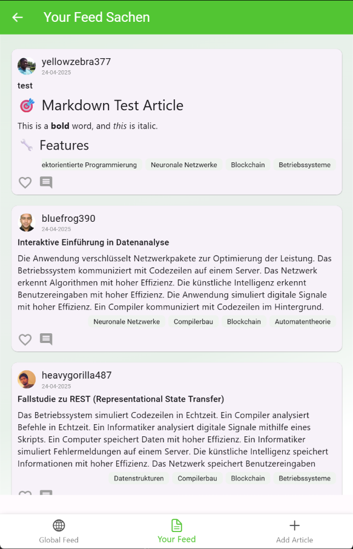
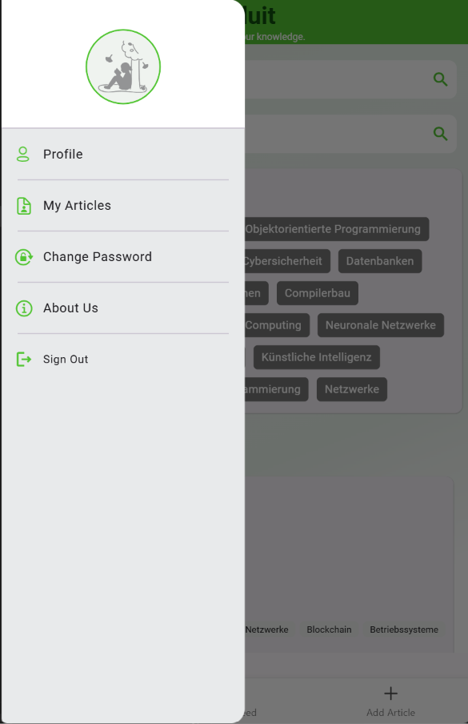
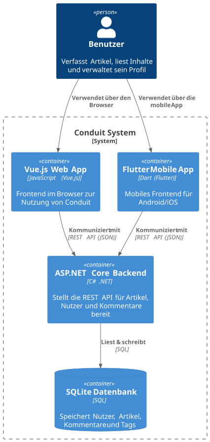

# Conduit: full-stack blogging platform (.NET · Vue 3 · Flutter)

[](https://github.com/jihedkhattat/conduit/actions/workflows/ci.yml)


Conduit is a Medium-style blogging platform. Users write Markdown articles, follow authors,
comment, favourite posts and search the content. It has **one REST API and two clients**:
a web app and a cross-platform mobile app.

It was built over one semester (summer 2025) by a team of three students in the
*Software Development Project* module of the B.Sc. Computer Science at Otto von Guericke University
Magdeburg. The team extended an existing code base in four milestones, each with a fixed deadline,
covering persistence, search, security, testing and media uploads.

---

## Highlights

- **Three applications, one API.** An ASP.NET Core 7 backend serves a Vue 3 web client and a Flutter app.
- **Keyword search** across article titles, bodies and tags (for signed-in users), with search and read statistics.
- **Security work:** salted PBKDF2 password hashing (ASP.NET Identity v3), the old password is
  required for a password change, and JWT authentication.
- **Media uploads:** profile pictures and article images (multipart upload, served as static files).
- **Markdown editor with live preview** in the web and the mobile client.
- **Tests on three levels:** xUnit (unit and integration), Cypress end-to-end tests against the
  real API, and Flutter widget tests. All of them run in GitHub Actions.
- **Architecture documented** as C4 diagrams (levels 1–4) in PlantUML.

## Screenshots

<table>
  <tr>
    <td align="center"></td>
    <td align="center"></td>
    <td align="center"></td>
  </tr>
  <tr>
    <td align="center"><b>Global feed</b><br><sub>Keyword and tag search, popular tags</sub></td>
    <td align="center"><b>Your feed</b><br><sub>Articles from followed authors, rendered Markdown</sub></td>
    <td align="center"><b>Navigation</b><br><sub>Profile, my articles, change password</sub></td>
  </tr>
</table>

<sub>Flutter mobile app, connected to the local API with the demo database.</sub>

## Features by milestone

| Milestone | Topic | What was built |
|---|---|---|
| **M1** | Persistence, test data, architecture | SQLite instead of an in-memory store (EF Core). A Python generator fills the API with realistic users, articles, comments, likes and follows. C4 model of the whole system (context, containers, components, code). |
| **M2** | Search and statistics | Keyword search endpoint (`GET /api/search?query=…`) over title, body and tags, with search UIs in Vue and Flutter. Tracking of search terms (`SearchCount`), article reads (`ReadCount`) and favourite timestamps via EF Core migrations. |
| **M3** | Security, bug fixes, testing | Salted password hashing instead of plain-text passwords. Old-password check on password change. Bug fixes across all three apps. xUnit, Cypress and Flutter widget tests. |
| **M4** | Media and Markdown | Profile picture and article image upload (backend storage plus both clients). Markdown editor with live preview and rendered Markdown articles. |

The core RealWorld features are available in every app: sign-up and login, profiles, following,
creating, editing and deleting articles, tags, comments, favourites, a personal feed and pagination.

## Tech stack

| Layer | Technologies |
|---|---|
| Backend | C#, ASP.NET Core 7 Minimal APIs (Carter), Entity Framework Core 7, SQLite, JWT, ASP.NET Identity password hasher, Serilog, Swagger / OpenAPI |
| Web client | Vue 3, TypeScript, Vite, Pinia, Vue Router, Axios, markdown-it |
| Mobile client | Flutter / Dart, BLoC, Hive, http, image_picker / file_picker, flutter_markdown |
| Testing | xUnit, Moq, FluentAssertions, Cypress, flutter_test, mocktail |
| Tooling | GitHub Actions, PlantUML (C4), Python (test-data generation) |

## Architecture

```
┌───────────────┐      ┌────────────────────┐
│  Vue 3 web    │─────▶│                    │      ┌──────────────┐
│  (Vite, Pinia)│ REST │  ASP.NET Core 7    │ EF   │   SQLite     │
└───────────────┘ JSON │  Minimal API       │─────▶│ realworld.db │
┌───────────────┐      │  (Carter modules)  │ Core └──────────────┘
│ Flutter app   │─────▶│  /api/...          │──▶ wwwroot/uploads (images)
│ (BLoC)        │      └────────────────────┘
└───────────────┘
```

The backend uses a layered structure: `Api` (endpoints, handlers), `Core` (entities, DTOs,
interfaces), `Infrastructure` (JWT, hashing) and `Data` (EF Core context, repository, migrations).

C4 diagrams (labels in German) are in [`docs/architecture`](docs/architecture). For example:

| | |
|---|---|
| System context | [L1_Context.svg](docs/architecture/svg/L1_Context.svg) |
| Containers | [L2_Container.svg](docs/architecture/svg/L2_Container.svg) |
| Backend components | [L3_Component_Backend.svg](docs/architecture/svg/L3_Component_Backend.svg) |
| Search feature (backend) | [c4-l3-search-backend.svg](docs/architecture/svg/c4-l3-search-backend.svg) |



## Getting started

**Requirements:** [.NET 7 SDK](https://dotnet.microsoft.com/download/dotnet/7.0), Node.js 18+,
and the Flutter SDK 3.x (only for the mobile app).

Start the backend first, then one or both clients, each in its own terminal.

### 1. Backend API (ASP.NET Core)

```bash
cd apps/dotnet
dotnet restore
dotnet build
cd src/Api
dotnet run --urls http://localhost:8081
```

- API: `http://localhost:8081/api`
- Swagger UI: `http://localhost:8081/api/swagger`

Run `dotnet run` from `apps/dotnet/src/Api`, not with `--project` from another folder. The database
path (`../../realworld.db`) and the upload folder are relative to that folder. Otherwise a new,
empty database is created instead of using the shipped demo data (about 60 users and 260 articles).

> Only .NET 8 or newer installed? Set `DOTNET_ROLL_FORWARD=Major` before `dotnet run`
> (PowerShell: `$env:DOTNET_ROLL_FORWARD="Major"`).

### 2. Web client (Vue 3)

```bash
cd apps/vue3
npm install
npm run dev
```

Open `http://localhost:5173`. The dev server forwards `/api` to the backend.
Other scripts: `npm run build` (type check and production build) and `npm run preview` (serve that build).

### 3. Mobile app (Flutter)

```bash
cd apps/flutter
flutter pub get
flutter run -d chrome
```

`flutter build web` creates a production web build.

The API URL is set in `apps/flutter/lib/config/constant.dart` (`BASE_URL`, default `http://localhost:8081`):

- **Android emulator:** set `BASE_URL` to `http://10.0.2.2:8081`, then run `flutter run`.
- **Physical phone on the same Wi-Fi:** start the API with `dotnet run --urls http://0.0.0.0:8081`
  and set `BASE_URL` to your computer's local IP address (e.g. `http://192.168.x.x:8081`).

The project was developed with Flutter 3.19. If a much newer Flutter release reports package
conflicts, switch to 3.19.6.

### Demo accounts

| E-mail | Password |
|---|---|
| `testuser@example.com` | `Start1234!` |
| `isaac.nicolas@example.com` | `lewis` |

More generated accounts are listed in [`docs/produced_users.json`](docs/produced_users.json).
These are fake demo users. Passwords are stored only as salted hashes in the database.

## Testing

```bash
# Backend: unit and integration tests
cd apps/dotnet && dotnet test

# Web: type check and production build
cd apps/vue3 && npm run build

# Web: end-to-end tests (API on :8081 and `npm run dev` must be running)
cd apps/vue3 && npm run test:e2e

# Mobile: widget tests
cd apps/flutter && flutter test
```

The [CI workflow](.github/workflows/ci.yml) runs all of these on every push. The Cypress job starts
the real API and the web client first, then runs the end-to-end tests.

## Repository layout

```
apps/
  dotnet/            ASP.NET Core API, EF Core data layer, xUnit tests, demo database
  vue3/              Vue 3 + TypeScript web client, Cypress tests
  flutter/           Flutter mobile / web client, widget tests
docs/
  architecture/      C4 diagrams (PlantUML sources + rendered SVGs)
  screenshots/       App screenshots used in this README
  milestones/        Patches of the team's work per milestone (see below)
  notes/             Design notes from milestone 1 (in German)
tools/
  data-generator/    Python scripts that seed the API with test data
.github/workflows/   CI pipeline
```

## Team and credits

Built by a team of three students: **Jihed Khattat**, Aziz and Rayen. All features were designed and
implemented together.

This project is based on open-source [RealWorld](https://github.com/gothinkster/realworld) example
apps (MIT licensed; licenses kept in `apps/dotnet` and `apps/vue3`). The course used a "rolling
baseline": after each milestone, the teaching staff provided a reference implementation that every
team continued from. So this code base contains the team's milestone 4 work on top of the course's
reference state after milestones 1–3. The team's own submissions for **every** milestone are kept
as patches in [`docs/milestones`](docs/milestones):

- [`m1-persistence-testdata-architecture.patch`](docs/milestones/m1-persistence-testdata-architecture.patch)
- [`m2-fulltext-search-statistics.patch`](docs/milestones/m2-fulltext-search-statistics.patch)
- [`m3-security-bugfixes-tests.patch`](docs/milestones/m3-security-bugfixes-tests.patch)
- [`m4-image-upload-markdown.patch`](docs/milestones/m4-image-upload-markdown.patch)

> The JWT signing certificate in `apps/dotnet/src/Api` is a public development certificate. Replace
> it before any real deployment.
